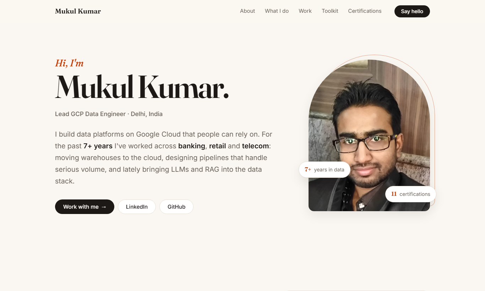

<div align="center">

# Mukul Kumar

### Lead GCP Data Engineer

I build data platforms on Google Cloud that teams can trust.<br>
7+ years across **banking**, **retail** and **telecom**.

[](https://mkk96.github.io/)
[](https://www.linkedin.com/in/mukul-kumar-60322616b/)
[](mailto:mukul.kumar2@protonmail.com)

<a href="https://mkk96.github.io/">
  
</a>

</div>

---

## What I do

| | |
|---|---|
| 🏗️ **Data platform architecture** | Scalable platforms on BigQuery, Cloud Storage, Pub/Sub, Dataflow and Dataproc |
| 🔄 **Batch & streaming pipelines** | Cloud-native ETL/ELT with Python, SQL and Apache Airflow |
| ☁️ **Cloud migration** | On-prem warehouses to BigQuery, with data quality checks, reconciliation and GDPR compliance |
| ⚙️ **Infrastructure as Code & CI/CD** | Terraform-provisioned GCP and Tekton pipelines on Kubernetes |
| 🤖 **LLM & RAG** | Retrieval-Augmented Generation built into data platform workflows |
| 👥 **Technical leadership** | Leading engineering teams through planning, code reviews and on-time delivery |

## Tech stack


## Certifications

- 🏅 Google Cloud Certified **Professional Data Engineer**
- 🏅 Google Cloud Certified **Professional Machine Learning Engineer**
- Google Cloud Certified Generative AI Leader
- Google Cloud Certified Associate Data Practitioner
- Google Cloud Certified Cloud Digital Leader
- Claude Certified Associate: Foundations (Anthropic)
- GitHub Copilot Certification
- Databricks Certified Data Engineer Associate
- Databricks Certified Data Analyst Associate
- Microsoft Certified: Azure AI Fundamentals
- PCAP: Certified Associate in Python Programming

## Education

- **M.Tech, Computer Science & Engineering**, IIIT Hyderabad (2021 – 2023)
- **B.Tech, Computer Science & Engineering**, Jamia Millia Islamia, Delhi (2015 – 2019)

---

## About this site

The source of [mkk96.github.io](https://mkk96.github.io/), my single-page personal intro served by GitHub Pages. It has no framework and no build step: just HTML, CSS and a little JavaScript.

- Responsive from phones to wide screens, with automatic light and dark themes
- Scroll-reveal animations that respect `prefers-reduced-motion`
- Accessible markup: semantic sections, a skip link, keyboard focus styles and ARIA on the mobile menu
- SEO-ready, with meta description, Open Graph tags and JSON-LD `Person` schema

```
mkk96.github.io/
├── index.html        # page content and structure
├── styles/main.css   # colours, typography, layout, light/dark themes
├── scripts/main.js   # mobile menu, scroll reveal, active nav, copy email
└── images/           # profile photo and README preview
```

**Run locally:** open `index.html` in a browser, or serve the folder:

```bash
python -m http.server 8000
# then visit http://localhost:8000
```

<div align="center">

<sub>Open to data engineering engagements · <a href="mailto:mukul.kumar2@protonmail.com">mukul.kumar2@protonmail.com</a></sub>

</div>
